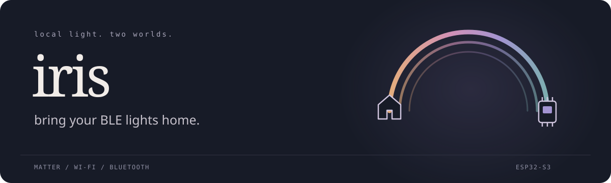

<p align="center">
  
</p>

<p align="center">
  <a href="https://github.com/GustavoWidman/iris/actions/workflows/host-tests.yml"></a>
  
  <a href="LICENSE"></a>
</p>

# iris

bring your BLE lights home.

## what is this?

i wanted my cheap Bluetooth LEDs in Apple Home without replacing the controller.
so now there's an ESP32 translating between Matter and a thing called `BJ_LED`.
a perfectly reasonable amount of firmware for turning a light off. mostly.

```text
Apple Home  ── Matter / Wi-Fi ──  ESP32-S3  ── BLE / EE01 ──  BJ_LED
```

named after the Greek messenger of the rainbow. it felt appropriate.

## what works?

- local Apple Home pairing and physical light control on the tested setup.
- on/off requests, brightness and RGB, with HSV, XY and color-temperature inputs.
- saved Matter pairing and Wi-Fi across normal reboots, plus BLE reconnection.
- keeping the existing controller, strip and IR remote. no rewiring the LEDs.
- temporary exact-RGB diagnostics and host tests that don't need a board.

it's been used with **one ESP32-S3-WROOM / 16 MB flash board and one `BJ_LED`
controller**. not every similarly named controller, not every ESP32, and definitely
not a certified Matter product.

## the catch

BLE state is **optimistic**. “the write succeeded” means the local API accepted
some bytes, not that the strip did what i asked. the original app/remote can also
change the lights without telling Home.

an ordinary `off` request once left the LEDs lit. exact `rgb 0 0 0` was confirmed
dark on this unit, but that isn't proof of controller power-off or a universal fix.
observe the strip; don't use this for lighting you need to trust.

mixed colors are nonlinear. a tiny blue value can make a surprisingly large
difference. an opt-in [relative-balance profile](docs/experimental-relative-balance.md)
was built and tried through Apple Home on this setup: “not perfect, but pretty
damn good.” i'll take it. that's one person's verdict, not calibrated colorimetry
or a promise about your strip. identity is still the default; purple, dim mixtures,
white temperature and long-term reliability aren't established. the XY conversion
math has regression tests; physical color accuracy does not magically follow.

no music mode, effects, OTA updates or cloud relay. a local Home setup worked
without an Apple TV/HomePod, but that doesn't promise remote access, automations,
or the same result on every iOS version. [Apple's hub rules still apply](https://support.apple.com/en-us/102135).

## getting started

you'll need an **ESP32-S3 with 16 MB flash**, USB power, a compatible `BJ_LED`
controller and 2.4 GHz Wi-Fi. close MohuanLED so it releases the BLE connection.
the ESP32 doesn't connect electrically to the strip.

```sh
git clone https://github.com/GustavoWidman/iris.git
cd iris
bash tools/test-host.sh
```

that's the hardware-free check: C++17, Bash and Python 3. nothing gets flashed.

for the actual firmware, follow [setup](docs/setup.md): ESP-IDF **v5.5**,
ESP-Matter **release/v1.5** (tested commits listed there), unique private settings,
then a local build and deliberate flash. no prebuilt binaries; putting my Wi-Fi
password in a release would be a bit too convenient.

## technical jargon

for the nerds:

- one ESP-Matter/NimBLE host handles BLE commissioning and central control.
- one worker writes `EE01`; RGB frames are `69 96 05 02 RR GG BB`.
- Matter attributes become HSV/XY/CCT-derived RGB, then identity-default
  calibration, then a BLE write without response.
- desired state is saved to NVS. raw RGB overrides aren't; Matter updates win.
- the worker samples at 250 ms, with an 80 ms RGB-to-on gap. this can step or lag.
- `rgb R G B` / `resume` are local console diagnostics, not a network service.

| docs | what's in there |
| --- | --- |
| [setup](docs/setup.md) | SDKs, private config, build, commissioning, safe updates |
| [protocol](docs/protocol.md) | frames, conversion, optimistic state, persistence |
| [color investigation](docs/color-investigation.md) | observed response vs. what the code actually proves |
| [troubleshooting](docs/troubleshooting.md) | connection issues, bounded serial sessions, recovery |
| [contributing](CONTRIBUTING.md) | tests and hardware-evidence expectations |
| [security](SECURITY.md) | what not to accidentally upload |
| [attribution](THIRD_PARTY.md) | protocol research, algorithm origins, vendor licenses |

## layout

```text
main/         Matter light, BLE worker, conversion and protocol
examples/     non-functional private-config reference
tools/        local settings, onboarding and bounded diagnostics
tests/        hardware-free conversion, protocol, console and tooling checks
diagnostic/   separate legacy BLE-only firmware; not the Matter app
docs/         setup and engineering notes
```

## license

mit for original project code, docs and artwork. see [LICENSE](LICENSE).
Tanner Helland's Kelvin approximation retains its BSD-2-Clause notice; the
Espressif-derived configuration preset and separately fetched SDKs retain their
own licenses. details in [THIRD_PARTY.md](THIRD_PARTY.md).

not affiliated with Apple, Espressif, MohuanLED or the Matter standards body.
it's an ESP32 doing its best.
